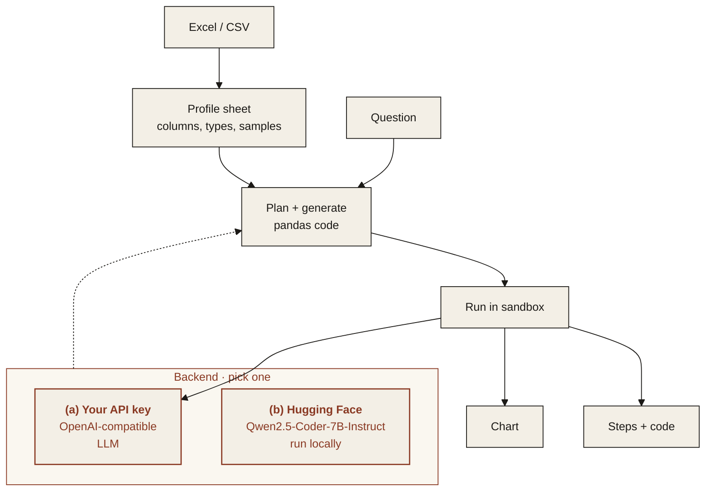

<p align="center">
  
</p>

<p align="center"><em>Ask a spreadsheet a question in plain language and get the answer, a chart and the steps.</em></p>

<p align="center">
  
  
  
  
</p>

---

## Features

- **Excel and CSV**: upload a file; sheets and headers are detected automatically.
- **Plain-language questions**: "Which region grew fastest last quarter?"
- **Answer and chart**: a direct answer plus a chart when one helps.
- **The steps**: the exact operations used, shown as readable steps and as code you can rerun.
- **Sandboxed execution**: generated code runs in a restricted sandbox, never on your raw files.

> **Data.** Examples use synthetic or public data only.

## Architecture



### Two interchangeable backends

Pick one with `MS_BACKEND` in `.env`. The rest of the pipeline does not change.

| | (a) Bring your own API key | (b) Open-source on Hugging Face |
|---|---|---|
| **What** | Any OpenAI-compatible endpoint | Open models, run locally or via Hugging Face Inference |
| **Set** | `MS_BACKEND=api`, `OPENAI_BASE_URL`, `OPENAI_API_KEY` | `MS_BACKEND=hf`, `HF_MODE=local` or `inference` |
| **Good for** | Fastest start, strongest hosted models | Data stays on your machines, no per-call cost |

**Default open-source models**

| Model | Used for | License |
|---|---|---|
| [`Qwen/Qwen2.5-Coder-7B-Instruct`](https://huggingface.co/Qwen/Qwen2.5-Coder-7B-Instruct) | planning and generating the analysis code | Apache-2.0 |
| [`Qwen/Qwen2.5-7B-Instruct`](https://huggingface.co/Qwen/Qwen2.5-7B-Instruct) | writing the answer in plain language | Apache-2.0 |

## Quickstart

> **Coming soon.** The commands below show the planned interface.

```bash
git clone https://github.com/ModelShifts/table-qa
cd table-qa
cp .env.example .env   # choose a backend
pip install -e .
table-qa ask sales.xlsx "Which region grew fastest last quarter?"
```

## Try it

> **Coming soon.** A hosted demo will be linked here and on [modelshifts.com/work](https://modelshifts.com/work).

## Roadmap

- [x] Repository scaffold and README
- [ ] Sheet profiling
- [ ] Question to code with either backend
- [ ] Sandboxed execution
- [ ] Answer, chart and steps
- [ ] Web demo

## License

[MIT](LICENSE) © Modelshifts Technology Pte. Ltd.

<p align="center"><sub>Part of the <a href="https://modelshifts.com/work">Modelshifts</a> showcase.</sub></p>
