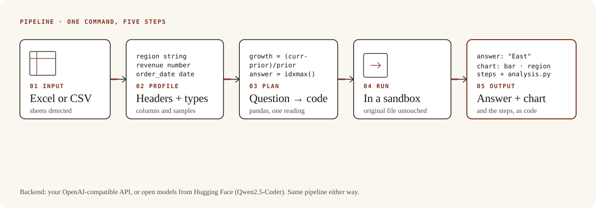
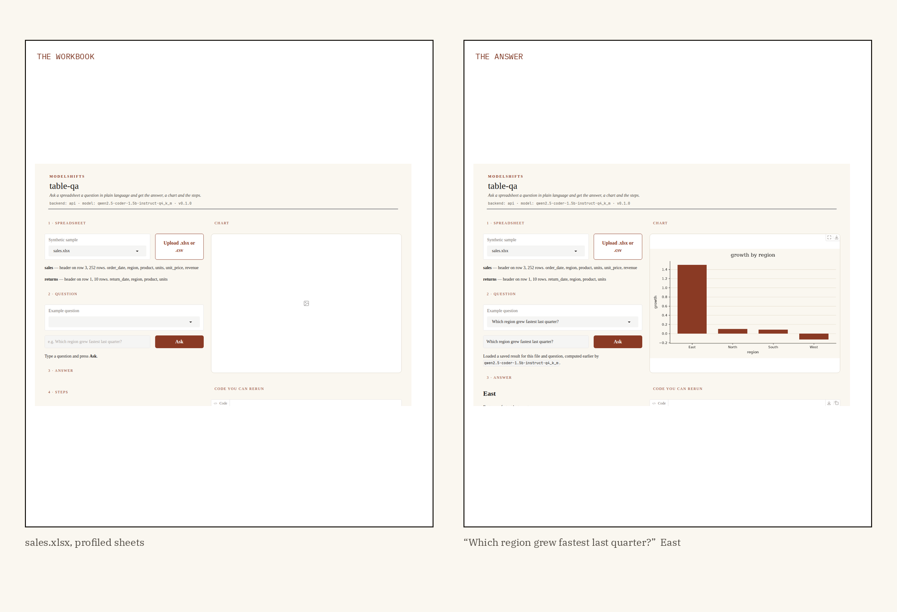

<p align="center">
  
</p>

<p align="center"><strong>A spreadsheet and a question go in. The answer, a chart and the steps that produced them come out.</strong></p>

<p align="center">
  <a href="https://github.com/ModelShifts/table-qa/actions/workflows/ci.yml"></a>
  
  
  
  
</p>

<p align="center">
  
</p>
<p align="center"><sub>Web demo on the synthetic workbook (<a href="assets/demo.mp4">MP4</a>). The recording replays a result computed by Qwen2.5-Coder-1.5B-Instruct (Q4_K_M) on CPU.</sub></p>

<p align="center">
  
</p>

## The problem

Imagine a sales workbook and a question: which region grew fastest last quarter? Someone opens the file, builds a pivot, and pastes a number into a slide. A different reading of “last quarter” gives a different number, and the steps that produced it are usually already gone.

The useful result is not a model that can “understand spreadsheets.” It is the number, the chart, and the exact steps — including the code — that produced them, so a person can rerun and check.

## How it works

The pipeline is five steps.

1. An Excel file or a CSV comes in. Sheets and the header row are detected automatically.
2. The file is profiled: columns, types, a few sample values.
3. A model writes pandas code for the question, using a single reading of phrases such as “last quarter” and “grew fastest.”
4. That code runs in a sandbox. The original file is not modified.
5. You get the computed value, a sentence, a chart when one helps, and the steps — shown as readable steps and as code you can rerun.

<p align="center">
  
</p>
<p align="center"><sub>The same five steps, whether the backend is your API or open models on your own machine.</sub></p>

One of the samples, before and after:

<p align="center">
  
</p>
<p align="center"><sub>Synthetic workbook <code>sales.xlsx</code>. Answer “East,” which matches the ground truth. Measured by <a href="scripts/evaluate.py"><code>scripts/evaluate.py</code></a>.</sub></p>

## Results

On seven questions against one synthetic sales workbook (and the same sales rows as a CSV), the API backend with Qwen2.5-Coder-1.5B-Instruct (Q4_K_M) got **6 of 7** values correct, in **20.1–103.5 seconds** per question on an 8-core CPU.

The one miss is `top_region`: “Which region has the highest total revenue?” expected North and came back as East.

| Id | Question | Expected | Got | Correct | Time (s) |
|---|---|---|---|---|---|
| latest_order_date | What is the latest order date? | 2026-09-15 | 2026-09-15 | yes | 24.9 |
| total_revenue | What is the total revenue? | 43290 | 43290 | yes | 31.0 |
| top_region | Which region has the highest total revenue? | North | East | no | 60.3 |
| top_product | Which product sold the most units? | Ash | Ash | yes | 51.4 |
| fastest_growth | Which region grew fastest last quarter? | East | East | yes | 103.5 |
| most_returns | Which region has the most returned units? | South | South | yes | 38.4 |
| csv_total_revenue | What is the total revenue? (sales.csv) | 43290 | 43290 | yes | 20.1 |
| **All** | | | | **6/7** | **20.1–103.5** |

**Methodology.** One synthetic workbook (`samples/sales.xlsx`, sheets `sales` and `returns`) and `samples/sales.csv`, seven questions in [`samples/questions.json`](samples/questions.json). All names and figures are fictional. A question counts as correct when the computed value matches that ground truth (dates as ISO, numbers exact, strings case-insensitive). The value comes from running the generated pandas in the sandbox, not from the wording of the sentence. “Last quarter” is the calendar quarter of the latest date; “grew fastest” is the largest percentage change in revenue between that quarter and the previous one. Run with [`python scripts/evaluate.py`](scripts/evaluate.py). API backend, Qwen2.5-Coder-1.5B-Instruct (Q4_K_M) behind a local llama.cpp server, 8-core CPU (15 GB RAM, no GPU), 12 November 2026. The raw table is in [`docs/eval.md`](docs/eval.md).

On the same machine, the Hugging Face backend with Qwen2.5-Coder-1.5B-Instruct (and Qwen2.5-1.5B-Instruct for the sentence, loaded one at a time) got **4 of 7**. `top_region` was correct there; `top_product`, `fastest_growth` and `most_returns` failed (the generated code looked up a `units` column that is not on the sales sheet, or returned no value). Times were 34.5–137.9 seconds. The raw table is in [`docs/eval-hf.md`](docs/eval-hf.md). The 7B default models have not been measured here.

## Why it matters

A number without the steps is a rumour. A number with the code that produced it is a claim you can rerun — from “East” back to the percentage-growth calculation, and reject it if the code is wrong. That is the difference between an answer you recompute to be safe, and an answer you can actually use.

It fits anywhere a team already keeps a spreadsheet and answers the same kinds of question from it. The backend can be a hosted API or open models on your own machine; the sandbox and the rest of the pipeline stay the same.

## Quickstart

Python 3.11 or newer.

```bash
git clone https://github.com/ModelShifts/table-qa
cd table-qa
python -m venv .venv && source .venv/bin/activate
pip install -e ".[hf,demo]"      # open models; use ".[api,demo]" for the API backend
cp .env.example .env              # choose a backend and models
```

On a CPU-only machine, install the CPU build of PyTorch first (`pip install torch --index-url https://download.pytorch.org/whl/cpu`) and set `MS_SMALL=1` in `.env`. That selects the 1.5B models, which are the ones measured above. Models download from Hugging Face on first use.

```bash
# sheets, the detected header row, and columns
table-qa profile samples/sales.xlsx

# answer, steps, and the code. Add --out DIR to also save chart.png and analysis.py
table-qa ask samples/sales.xlsx "Which region grew fastest last quarter?"

# the same question against the CSV
table-qa ask samples/sales.csv "What is the total revenue?"

# the web demo at http://127.0.0.1:7860 (python app.py does the same)
table-qa serve
```

`samples/` holds the synthetic workbook and CSV, with a ground-truth file for the seven questions. All names and figures are fictional. Tests use a mocked model and need no downloads: `pip install -e ".[dev]" && pytest`.

## Backends

<details>
<summary>Two interchangeable backends — API key or open models. The rest of the pipeline does not change.</summary>

Pick one with `MS_BACKEND` in `.env`.

| | (a) Bring your own API key | (b) Open-source on Hugging Face |
|---|---|---|
| **What** | Any OpenAI-compatible endpoint | Open models, run locally with `transformers` |
| **Set** | `MS_BACKEND=api`, `MS_API_BASE`, `MS_API_KEY`, `MS_MODEL` | `MS_BACKEND=hf`, optionally `MS_HF_CODE_MODEL` and `MS_HF_ANSWER_MODEL` |
| **Sentence** | `MS_ANSWER_MODEL` if set, otherwise `MS_MODEL` | `MS_HF_ANSWER_MODEL` |
| **Good for** | Fastest start, hosted models | Data stays on your machines, no per-call cost |

**Default open-source models**

| Model | Used for | License |
|---|---|---|
| [`Qwen/Qwen2.5-Coder-7B-Instruct`](https://huggingface.co/Qwen/Qwen2.5-Coder-7B-Instruct) | planning and generating the analysis code | Apache-2.0 |
| [`Qwen/Qwen2.5-7B-Instruct`](https://huggingface.co/Qwen/Qwen2.5-7B-Instruct) | writing the answer in plain language | Apache-2.0 |

On a machine without a GPU, set `MS_SMALL=1`. That selects [`Qwen/Qwen2.5-Coder-1.5B-Instruct`](https://huggingface.co/Qwen/Qwen2.5-Coder-1.5B-Instruct) for the code and [`Qwen/Qwen2.5-1.5B-Instruct`](https://huggingface.co/Qwen/Qwen2.5-1.5B-Instruct) for the sentence. On CPU the two models are loaded one at a time. The 7B defaults need a GPU and have not been measured here.

To try the API backend without a paid key, run an open model behind a local OpenAI-compatible server, for example [llama-cpp-python](https://github.com/abetlen/llama-cpp-python):

```bash
pip install "llama-cpp-python[server]" huggingface_hub \
  --extra-index-url https://abetlen.github.io/llama-cpp-python/whl/cpu
hf download Qwen/Qwen2.5-Coder-1.5B-Instruct-GGUF qwen2.5-coder-1.5b-instruct-q4_k_m.gguf --local-dir models
python -m llama_cpp.server --model models/qwen2.5-coder-1.5b-instruct-q4_k_m.gguf --n_ctx 8192 --port 8001
# then: MS_BACKEND=api MS_API_BASE=http://127.0.0.1:8001/v1 MS_API_KEY=local MS_MODEL=qwen2.5-coder-1.5b-instruct-q4_k_m
```

Generated code runs in a subprocess with a timeout, no new sockets, and a read-only copy of the file. The original file is not modified. One header row per sheet is supported; merged cells, pivot layouts and `.xls` files are not. Macros are not run.

</details>

## Notes

- Measured on one synthetic workbook and seven questions, not on real workbooks.
- The 6/7 figure is for Qwen2.5-Coder-1.5B-Instruct (Q4_K_M) on the API backend. The same size on the Hugging Face backend got 4/7. The 7B defaults have not been measured here.
- The sentence is the model’s wording of the computed value. The value itself comes from running the code.
- The sandbox is a restriction, not a multi-user security boundary.

## Roadmap

- [ ] Hosted demo
- [ ] Merged cells and pivot layouts

## License

[MIT](LICENSE) © Modelshifts Technology Pte. Ltd.

<p align="center"><sub>Part of the <a href="https://modelshifts.com/work">Modelshifts</a> showcase. November 2026, v1.</sub></p>
