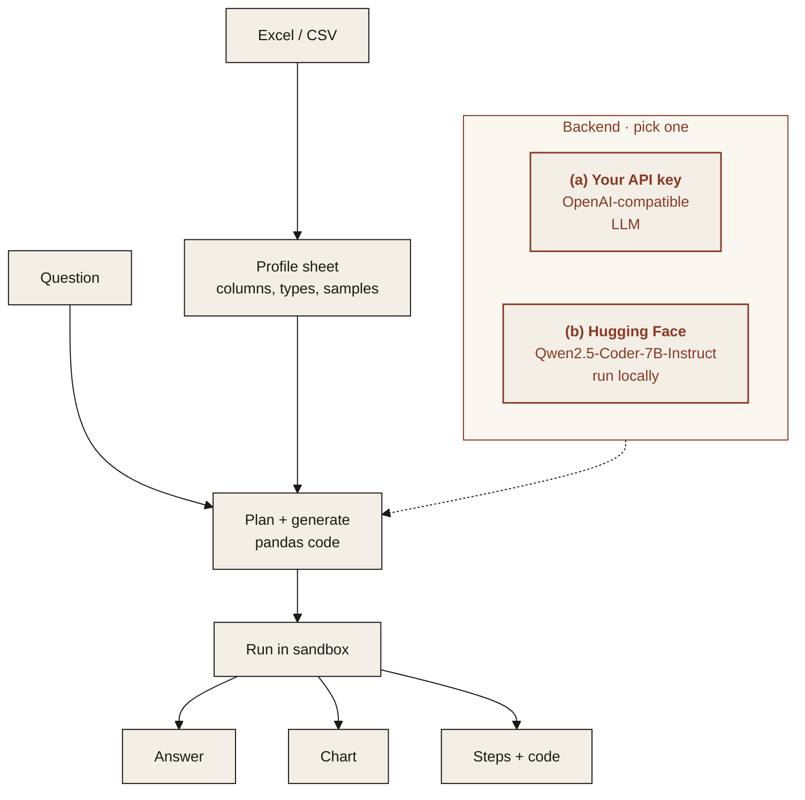

<p align="center">
  
</p>

<p align="center"><em>Ask a spreadsheet a question in plain language and get the answer, a chart and the steps.</em></p>

<p align="center">
  
  
  
  
</p>

---

## Features

All five features below work in v1. See [Limitations](#limitations) for what they do not cover yet.

- **Excel and CSV**: upload a file; sheets and headers are detected automatically.
- **Plain-language questions**: "Which region grew fastest last quarter?"
- **Answer and chart**: a direct answer plus a chart when one helps.
- **The steps**: the exact operations used, shown as readable steps and as code you can rerun.
- **Sandboxed execution**: generated code runs in a restricted sandbox and never modifies your original file.

<p align="center">
  
</p>
<p align="center"><sub>Web demo on the synthetic workbook (<a href="assets/demo.mp4">MP4</a>). The result in the recording was computed earlier by Qwen2.5-Coder-1.5B-Instruct on CPU and loaded from the demo's result cache.</sub></p>

> **Data.** Examples use synthetic or public data only.

## Architecture



### Two interchangeable backends

Pick one with `MS_BACKEND` in `.env`. The rest of the pipeline does not change.

| | (a) Bring your own API key | (b) Open-source on Hugging Face |
|---|---|---|
| **What** | Any OpenAI-compatible endpoint | Open models, run locally with `transformers` |
| **Set** | `MS_BACKEND=api`, `MS_API_BASE`, `MS_API_KEY`, `MS_MODEL` | `MS_BACKEND=hf`, optionally `MS_HF_CODE_MODEL` and `MS_HF_ANSWER_MODEL` |
| **Sentence** | `MS_ANSWER_MODEL` if set, otherwise `MS_MODEL` | `MS_HF_ANSWER_MODEL` |
| **Good for** | Fastest start, strongest hosted models | Data stays on your machines, no per-call cost |

**Default open-source models**

| Model | Used for | License |
|---|---|---|
| [`Qwen/Qwen2.5-Coder-7B-Instruct`](https://huggingface.co/Qwen/Qwen2.5-Coder-7B-Instruct) | planning and generating the analysis code | Apache-2.0 |
| [`Qwen/Qwen2.5-7B-Instruct`](https://huggingface.co/Qwen/Qwen2.5-7B-Instruct) | writing the answer in plain language | Apache-2.0 |

On a machine without a GPU, set `MS_SMALL=1`. That selects [`Qwen/Qwen2.5-Coder-1.5B-Instruct`](https://huggingface.co/Qwen/Qwen2.5-Coder-1.5B-Instruct) for the code and [`Qwen/Qwen2.5-1.5B-Instruct`](https://huggingface.co/Qwen/Qwen2.5-1.5B-Instruct) for the sentence. On CPU the two models are loaded one at a time. The 7B models need a GPU or a lot of memory.

## Quickstart

Python 3.11 or newer.

```bash
git clone https://github.com/ModelShifts/table-qa
cd table-qa
python -m venv .venv && source .venv/bin/activate
pip install -e ".[hf,demo]"      # open models; use ".[api,demo]" for the API backend
cp .env.example .env              # choose a backend and models
```

On a CPU-only machine, install the CPU build of PyTorch first (`pip install torch --index-url https://download.pytorch.org/whl/cpu`) and set `MS_SMALL=1` in `.env`. Models download from Hugging Face on first use.

```bash
# sheets, the detected header row, and columns
table-qa profile samples/sales.xlsx

# answer, steps, and the code. Add --out DIR to also save chart.png and analysis.py
table-qa ask samples/sales.xlsx "Which region grew fastest last quarter?"

# the same question against the CSV
table-qa ask samples/sales.csv "What is the total revenue?"

# the web demo at http://127.0.0.1:7860 (python app.py does the same)
table-qa serve
```

### Questions

The model writes pandas against the profiled sheets. A few phrases are defined so the same question has one reading:

- **Last quarter** is the calendar quarter of the latest date in the date column. The profile names that quarter and the one before it.
- **Grew fastest** is the largest percentage change in revenue, `(latest - previous) / previous`. On the returns sheet the measure is units.
- **Highest** and **most** use the whole sheet, not only the last quarter.

The computed value is the answer. A second model call turns that value into a sentence. A comparison gets a bar or line chart when the code builds one.

### Using the API backend

Any OpenAI-compatible endpoint works. In `.env`:

```bash
MS_BACKEND=api
MS_API_BASE=https://your-provider.example/v1
MS_API_KEY=your-api-key
MS_MODEL=your-chat-model
```

To try it without a paid key, run an open model behind a local OpenAI-compatible server, for example [llama-cpp-python](https://github.com/abetlen/llama-cpp-python). The coder model writes the code and, with one server, the sentence too:

```bash
pip install "llama-cpp-python[server]" huggingface_hub \
  --extra-index-url https://abetlen.github.io/llama-cpp-python/whl/cpu   # prebuilt CPU wheels, no compiler needed
hf download Qwen/Qwen2.5-Coder-1.5B-Instruct-GGUF qwen2.5-coder-1.5b-instruct-q4_k_m.gguf --local-dir models
python -m llama_cpp.server --model models/qwen2.5-coder-1.5b-instruct-q4_k_m.gguf --n_ctx 8192 --port 8001
# then: MS_BACKEND=api MS_API_BASE=http://127.0.0.1:8001/v1 MS_API_KEY=local MS_MODEL=qwen2.5-coder-1.5b-instruct-q4_k_m
```

### Sandbox

Generated code runs in a subprocess. The original file is only read. The child gets a read-only copy in a temporary directory, a timeout (`MS_SANDBOX_TIMEOUT`, default 30 seconds), and no network: on Linux x86_64 a seccomp filter denies new sockets. Writes to the copy and writes outside the work directory are refused. The code you see in the result is a script that reloads the file with the detected header row and reruns the analysis.

### Sample files and tests

`samples/` holds a synthetic workbook (`sales.xlsx`, sheets `sales` and `returns`) and the same sales rows as `sales.csv`. A title line sits above the sales header so header detection has something to skip. `samples/questions.json` lists questions whose answers are computed from those files. All names and figures are fictional.

```bash
pip install -e ".[dev]"
python scripts/make_samples.py   # regenerate samples/
pytest                           # uses a mocked model, no downloads
python scripts/evaluate.py       # compare the configured backend with the ground truth
```

## Limitations

- The samples are synthetic and small. The project has not been measured on real workbooks here. With the 1.5B models, some questions in `samples/questions.json` come back wrong. `python scripts/evaluate.py` prints the comparison.
- On a CPU, a 1.5B model takes a few seconds to a few minutes per question. The 7B defaults need a GPU. On CPU the open models load one at a time.
- The sandbox blocks new sockets, times out, and refuses writes to the data copy and to paths outside its work directory. It is not a multi-user security boundary: the process can still read other files it can read, and a program that walks interpreter frames can recover the real `open`.
- Charts are one bar or line series drawn from the table the code builds.
- One header row per sheet. Merged cells, pivot layouts and `.xls` files are not supported. Macros are not run.
- "Last quarter" and "grew fastest" use the definitions above. A different reading of the question will not match them.
- The sentence is the model's wording of the computed value. The value itself comes from running the code.
- The Hugging Face Inference API is not used. Open models run locally with `transformers`.
- The web demo saves results under `.cache/results` and reuses them for the same file, question and model.

## Roadmap

- [x] Repository scaffold and README
- [x] Sheet profiling
- [x] Question to code with either backend
- [x] Sandboxed execution
- [x] Answer, chart and steps
- [x] Web demo
- [ ] Hosted demo
- [ ] Merged cells and pivot layouts

## License

[MIT](LICENSE) © Modelshifts Technology Pte. Ltd.

<p align="center"><sub>Part of the <a href="https://modelshifts.com/work">Modelshifts</a> showcase.</sub></p>
